# Домашнее задание к занятию 4 «Оркестрация группой Docker контейнеров на примере Docker Compose» Чеботников М.Б.

### Инструкция к выполению

1. Для выполнения заданий обязательно ознакомьтесь с [инструкцией](https://github.com/netology-code/devops-materials/blob/master/cloudwork.MD) по экономии облачных ресурсов. Это нужно, чтобы не расходовать средства, полученные в результате использования промокода.
2. Практические задачи выполняйте на личной рабочей станции или созданной вами ранее ВМ в облаке.
3. Своё решение к задачам оформите в вашем GitHub репозитории в формате markdown!!!
4. В личном кабинете отправьте на проверку ссылку на .md-файл в вашем репозитории.

> **Окружение.** Задание выполнено на MacBook (macOS, Apple Silicon) с Docker Desktop (Engine 29.9.3, Docker Compose v2 — команда `docker compose`).
> Отличия от Linux, которые видны на скриншотах:
> - на macOS нет утилиты `ss`, вместо `ss -tlpn | grep 127.0.0.1:8080` использован `lsof -nP -iTCP:8080 -sTCP:LISTEN`;
> - `date` в macOS не поддерживает `%N`;
> - порт 5000 на macOS по умолчанию занят службой AirPlay Receiver — для задания 5 она была отключена.

## Задача 1

Сценарий выполнения задачи:
- Установите docker и docker compose plugin на свою linux рабочую станцию или ВМ.
- Если dockerhub недоступен создайте файл /etc/docker/daemon.json с содержимым: ```{"registry-mirrors": ["https://mirror.gcr.io", "https://daocloud.io", "https://c.163.com/", "https://registry.docker-cn.com"]}```
- Зарегистрируйтесь и создайте публичный репозиторий  с именем "custom-nginx" на https://hub.docker.com (ТОЛЬКО ЕСЛИ У ВАС ЕСТЬ ДОСТУП);
- скачайте образ nginx:1.21.1;
- Создайте Dockerfile и реализуйте в нем замену дефолтной индекс-страницы(/usr/share/nginx/html/index.html), на файл index.html с содержимым:
```
<html>
<head>
Hey, Netology
</head>
<body>
<h1>I will be DevOps Engineer!</h1>
</body>
</html>
```
- Соберите и отправьте созданный образ в свой dockerhub-репозитории c tag 1.0.0 (ТОЛЬКО ЕСЛИ ЕСТЬ ДОСТУП). 
- Предоставьте ответ в виде ссылки на https://hub.docker.com/<username_repo>/custom-nginx/general .

## Ответ 

Dockerfile:
```dockerfile
FROM nginx:1.21.1
COPY index.html /usr/share/nginx/html/index.html
```

```bash
docker pull nginx:1.21.1
docker build -t chebtnik/custom-nginx:1.0.0 .
docker login -u chebtnik
docker push chebtnik/custom-nginx:1.0.0
```

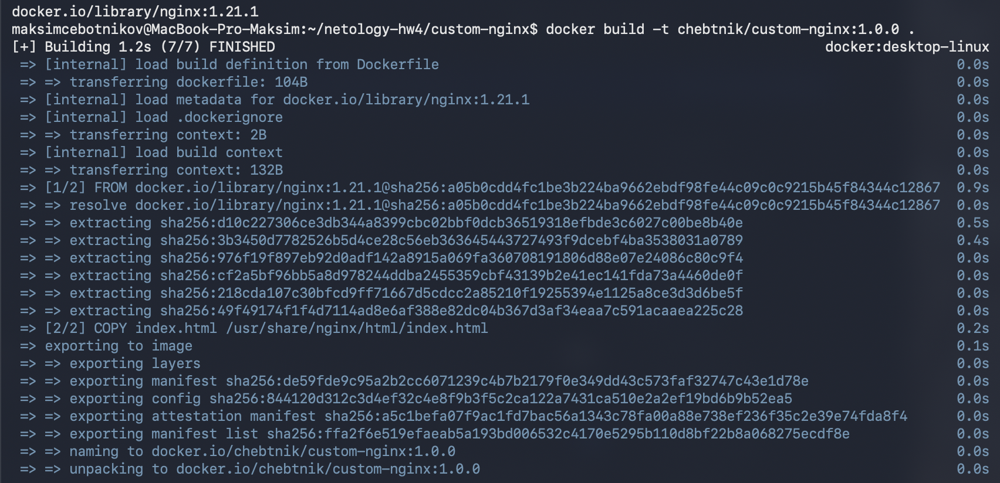

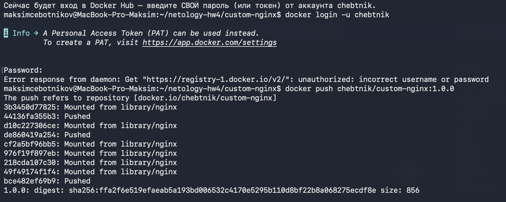

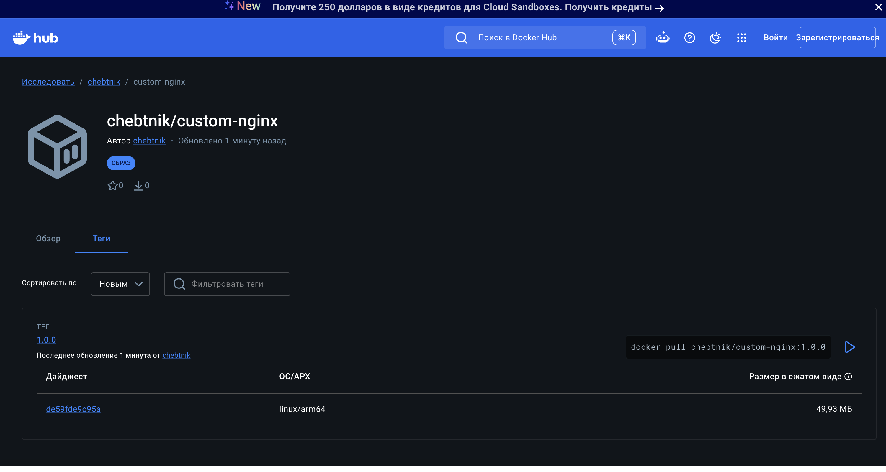

**Ссылка:** https://hub.docker.com/r/chebtnik/custom-nginx/tags (в личном кабинете: https://hub.docker.com/repository/docker/chebtnik/custom-nginx/general)

---

## Задача 2
1. Запустите ваш образ custom-nginx:1.0.0 командой docker run в соответвии с требованиями:
- имя контейнера "ФИО-custom-nginx-t2"
- контейнер работает в фоне
- контейнер опубликован на порту хост системы 127.0.0.1:8080
2. Не удаляя, переименуйте контейнер в "custom-nginx-t2"
3. Выполните команду ```date +"%d-%m-%Y %T.%N %Z" ; sleep 0.150 ; docker ps ; ss -tlpn | grep 127.0.0.1:8080  ; docker logs custom-nginx-t2 -n1 ; docker exec -it custom-nginx-t2 base64 /usr/share/nginx/html/index.html```
4. Убедитесь с помощью curl или веб браузера, что индекс-страница доступна.

В качестве ответа приложите скриншоты консоли, где видно все введенные команды и их вывод.

## Ответ 

```bash
docker run -d --name chebotnikovmb-custom-nginx-t2 -p 127.0.0.1:8080:80 chebtnik/custom-nginx:1.0.0
docker rename chebotnikovmb-custom-nginx-t2 custom-nginx-t2
date +"%d-%m-%Y %T.%N %Z" ; sleep 0.150 ; docker ps ; lsof -nP -iTCP:8080 -sTCP:LISTEN ; docker logs custom-nginx-t2 -n1 ; docker exec -it custom-nginx-t2 base64 /usr/share/nginx/html/index.html
curl http://127.0.0.1:8080
```

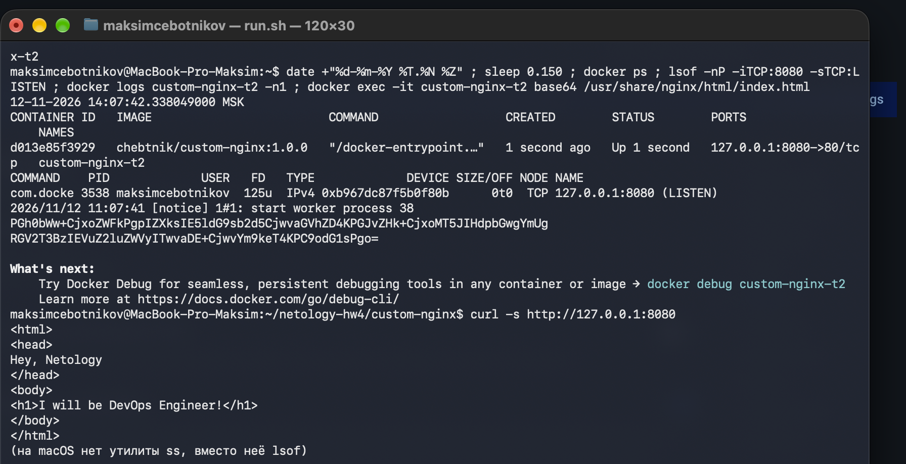

---

## Задача 3
1. Воспользуйтесь docker help или google, чтобы узнать как подключиться к стандартному потоку ввода/вывода/ошибок контейнера "custom-nginx-t2".
2. Подключитесь к контейнеру и нажмите комбинацию Ctrl-C.
3. Выполните ```docker ps -a``` и объясните своими словами почему контейнер остановился.
4. Перезапустите контейнер
5. Зайдите в интерактивный терминал контейнера "custom-nginx-t2" с оболочкой bash.
6. Установите любимый текстовый редактор(vim, nano итд) с помощью apt-get.
7. Отредактируйте файл "/etc/nginx/conf.d/default.conf", заменив порт "listen 80" на "listen 81".
8. Запомните(!) и выполните команду ```nginx -s reload```, а затем внутри контейнера ```curl http://127.0.0.1:80 ; curl http://127.0.0.1:81```.
9. Выйдите из контейнера, набрав в консоли  ```exit``` или Ctrl-D.
10. Проверьте вывод команд: ```ss -tlpn | grep 127.0.0.1:8080``` , ```docker port custom-nginx-t2```, ```curl http://127.0.0.1:8080```. Кратко объясните суть возникшей проблемы.
11. * Это дополнительное, необязательное задание. Попробуйте самостоятельно исправить конфигурацию контейнера, используя доступные источники в интернете. Не изменяйте конфигурацию nginx и не удаляйте контейнер. Останавливать контейнер можно. [пример источника](https://www.baeldung.com/linux/assign-port-docker-container)
12. Удалите запущенный контейнер "custom-nginx-t2", не останавливая его.(воспользуйтесь --help или google)

В качестве ответа приложите скриншоты консоли, где видно все введенные команды и их вывод.

## Ответ 

```bash
docker attach custom-nginx-t2   # затем Ctrl-C
docker ps -a
docker start custom-nginx-t2
```

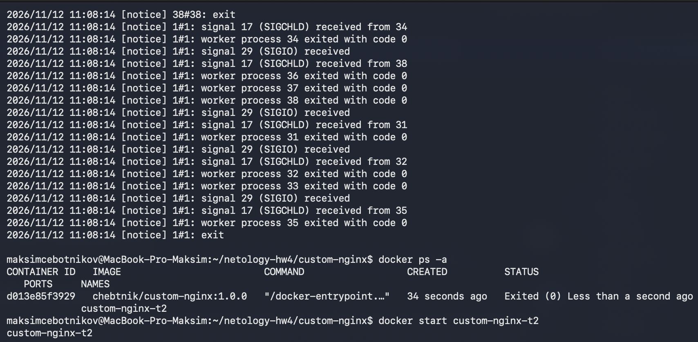

**Пункт 3. Почему контейнер остановился.**

Командой `docker attach custom-nginx-t2` я подключился к стандартным потокам ввода/вывода не «контейнера вообще», а его главного процесса — того, что запущен с PID 1. В образе nginx это мастер-процесс `nginx -g 'daemon off;'`. По умолчанию `docker attach` пробрасывает сигналы в контейнер (`--sig-proxy=true`), поэтому нажатие Ctrl-C отправило сигнал SIGINT прямо мастер-процессу nginx. Получив SIGINT, nginx завершил рабочие процессы и сам вышел — в логе это видно по строкам `worker process ... exited with code 0` и `1#1: exit`.

Контейнер живёт ровно столько, сколько живёт его процесс с PID 1. Как только nginx завершился, Docker перевёл контейнер в состояние `Exited (0)`, что и видно в `docker ps -a`. Чтобы отключиться, не останавливая контейнер, нужно было использовать комбинацию Ctrl-P, Ctrl-Q или подключаться с `docker attach --sig-proxy=false`.

---

Пункты 5–10: в контейнере установлен редактор nano (`apt-get install nano`; в образе nginx:1.21.1 Debian buster, поэтому источники apt переключены на archive.debian.org), в `/etc/nginx/conf.d/default.conf` строка `listen 80;` заменена на `listen 81;`, выполнены `nginx -s reload`, `curl http://127.0.0.1:80` (соединение отклонено) и `curl http://127.0.0.1:81` (страница отдаётся). Затем на хосте проверены порт, `docker port` и `curl http://127.0.0.1:8080`.

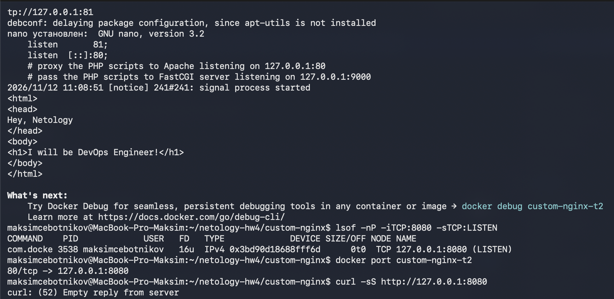

**Пункт 10. Суть проблемы.**

Docker пробрасывает порт хоста `127.0.0.1:8080` на порт **80** контейнера — это видно в `docker port custom-nginx-t2` (`80/tcp -> 127.0.0.1:8080`), и Docker продолжает слушать 8080 на хосте. Но после правки конфига и `nginx -s reload` nginx внутри контейнера слушает уже порт **81**, а на 80 никого нет. Поэтому запрос на 8080 доходит до контейнера, но там его некому принять — `curl: (52) Empty reply from server`. Исправить можно, либо вернув `listen 80` в конфиге nginx, либо изменив проброс портов на `8080 -> 81`.

Пункт 12 — удаление работающего контейнера без остановки: `docker rm -f custom-nginx-t2` (ключ `-f` посылает контейнеру SIGKILL и сразу удаляет его, отдельный `docker stop` не нужен).

---

## Задача 4

- Запустите первый контейнер из образа ***centos*** c любым тегом в фоновом режиме, подключив папку  текущий рабочий каталог ```$(pwd)``` на хостовой машине в ```/data``` контейнера, используя ключ -v.
- Запустите второй контейнер из образа ***debian*** в фоновом режиме, подключив текущий рабочий каталог ```$(pwd)``` в ```/data``` контейнера. 
- Подключитесь к первому контейнеру с помощью ```docker exec``` и создайте текстовый файл любого содержания в ```/data```.
- Добавьте ещё один файл в текущий каталог ```$(pwd)``` на хостовой машине.
- Подключитесь во второй контейнер и отобразите листинг и содержание файлов в ```/data``` контейнера.

В качестве ответа приложите скриншоты консоли, где видно все введенные команды и их вывод.

## Ответ 

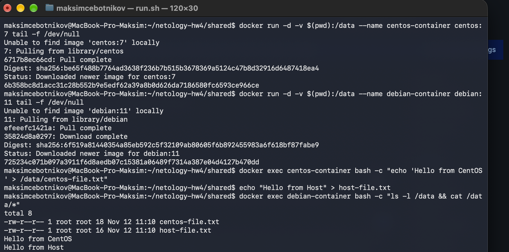

Файл, созданный в контейнере CentOS, и файл, созданный на хосте, видны во втором контейнере (Debian), потому что оба контейнера смонтировали один и тот же каталог хоста в `/data`.

---

## Задача 5

1. Создайте отдельную директорию(например /tmp/netology/docker/task5) и 2 файла внутри него.
"compose.yaml" с содержимым:
```
version: "3"
services:
  portainer:
    network_mode: host
    image: portainer/portainer-ce:latest
    volumes:
      - /var/run/docker.sock:/var/run/docker.sock
```
"docker-compose.yaml" с содержимым:
```
version: "3"
services:
  registry:
    image: registry:2

    ports:
    - "5000:5000"
```

И выполните команду "docker compose up -d". Какой из файлов был запущен и почему? (подсказка: https://docs.docker.com/compose/compose-application-model/#the-compose-file )

2. Отредактируйте файл compose.yaml так, чтобы были запущенны оба файла. (подсказка: https://docs.docker.com/compose/compose-file/14-include/)

3. Выполните в консоли вашей хостовой ОС необходимые команды чтобы залить образ custom-nginx как custom-nginx:latest в запущенное вами, локальное registry. Дополнительная документация: https://distribution.github.io/distribution/about/deploying/
4. Откройте страницу "https://127.0.0.1:9000" и произведите начальную настройку portainer.(логин и пароль адмнистратора)
5. Откройте страницу "http://127.0.0.1:9000/#!/home", выберите ваше local  окружение. Перейдите на вкладку "stacks" и в "web editor" задеплойте следующий компоуз:

```
version: '3'

services:
  nginx:
    image: 127.0.0.1:5000/custom-nginx
    ports:
      - "9090:80"
```
6. Перейдите на страницу "http://127.0.0.1:9000/#!/2/docker/containers", выберите контейнер с nginx и нажмите на кнопку "inspect". В представлении <> Tree разверните поле "Config" и сделайте скриншот от поля "AppArmorProfile" до "Driver".

7. Удалите любой из манифестов компоуза(например compose.yaml).  Выполните команду "docker compose up -d". Прочитайте warning, объясните суть предупреждения и выполните предложенное действие. Погасите compose-проект ОДНОЙ(обязательно!!) командой.

В качестве ответа приложите скриншоты консоли, где видно все введенные команды и их вывод, файл compose.yaml , скриншот portainer c задеплоенным компоузом.

## Ответ 

Все команды выполнены в каталоге `~/netology-hw4/task5` **без ключа `-f`** — Compose сам выбирает файл.

**Пункт 1. Какой файл запустился и почему.**

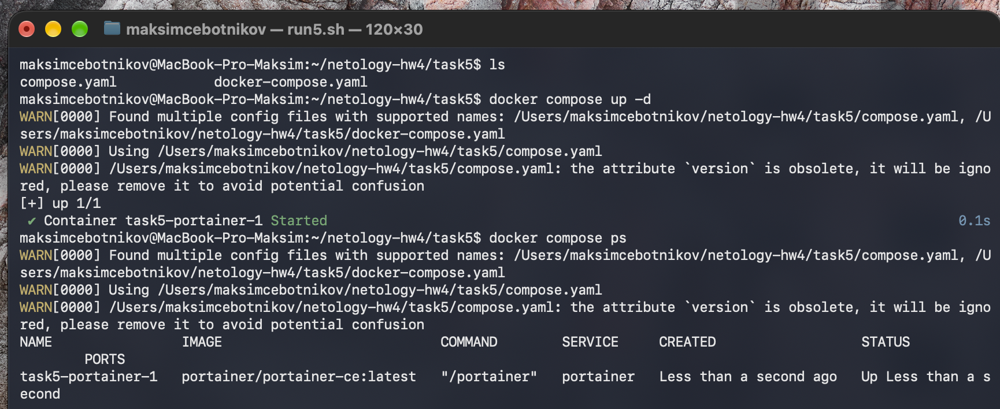

Запустился файл `compose.yaml` — поднялся только сервис **portainer**, а `registry` из `docker-compose.yaml` не запустился. Compose прямо пишет об этом: `Found multiple config files with supported names: .../compose.yaml, .../docker-compose.yaml` и `Using .../compose.yaml`.

Причина в приоритете имён файлов. Когда ключ `-f` не указан, Compose ищет файл в рабочем каталоге в строгом порядке: `compose.yaml` → `compose.yml` → `docker-compose.yaml` → `docker-compose.yml`. Берётся первый найденный файл, остальные игнорируются. `compose.yaml` — каноническое имя по спецификации Compose, а `docker-compose.yaml` поддерживается только ради обратной совместимости, поэтому у него приоритет ниже. Ключ `-f` этот механизм отключает (файл задаётся вручную), поэтому здесь он не используется.

**Пункт 2. Запуск обоих файлов через include.**

Итоговый `compose.yaml`:
```yaml
include:
  - docker-compose.yaml

services:
  portainer:
    network_mode: host
    image: portainer/portainer-ce:latest
    volumes:
      - /var/run/docker.sock:/var/run/docker.sock
```
(Строку `version` я убрал: в Compose v2 она устарела и только вызывает предупреждение `the attribute version is obsolete`.)

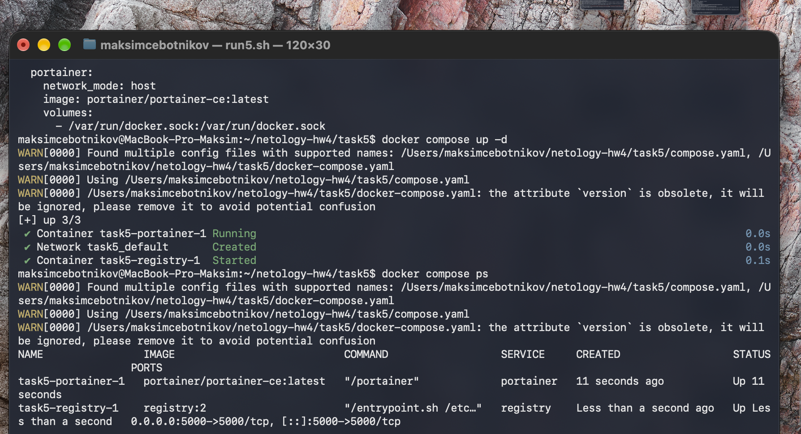

**Пункт 3. Загрузка образа в локальный registry.**
```bash
docker tag chebtnik/custom-nginx:1.0.0 127.0.0.1:5000/custom-nginx:latest
docker push 127.0.0.1:5000/custom-nginx:latest
curl http://127.0.0.1:5000/v2/_catalog
```

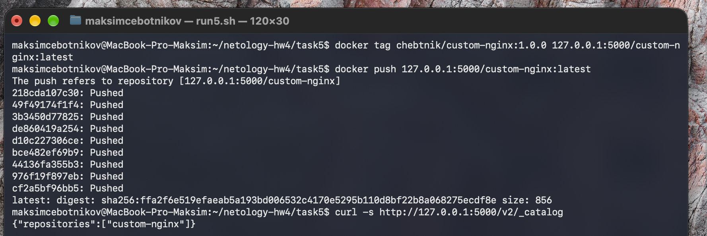

**Пункт 4. Начальная настройка Portainer** (создан администратор `admin`):

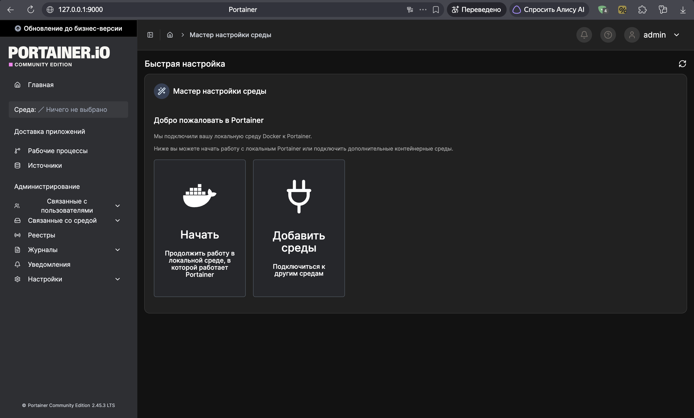

**Пункт 5. Стек `chebotnikov`, задеплоенный через Web editor** — контейнер `chebotnikov-nginx-1` из образа `127.0.0.1:5000/custom-nginx` запущен:

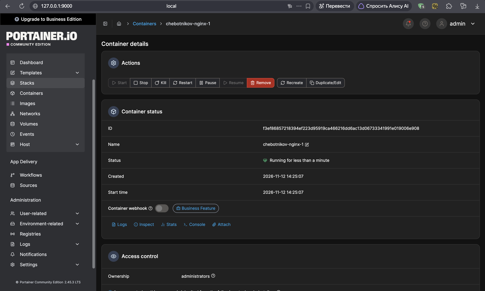

**Пункт 6. Inspect контейнера, Tree, раскрыт Config — от AppArmorProfile до Driver:**

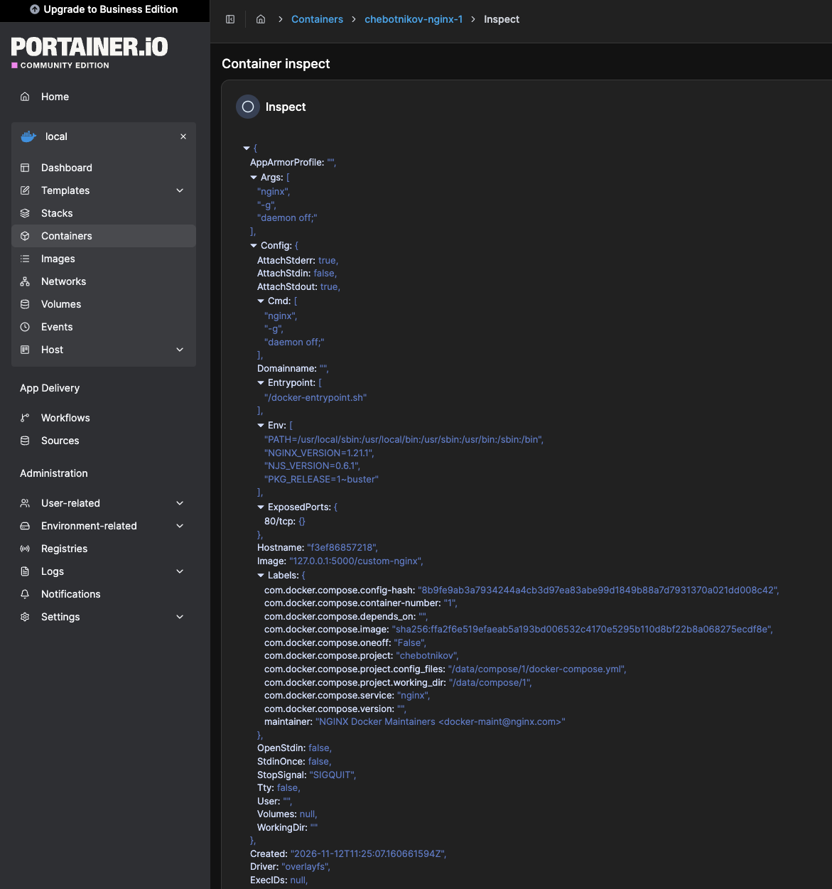

**Пункт 7. Warning после удаления compose.yaml.**

```bash
rm compose.yaml
docker compose up -d
```

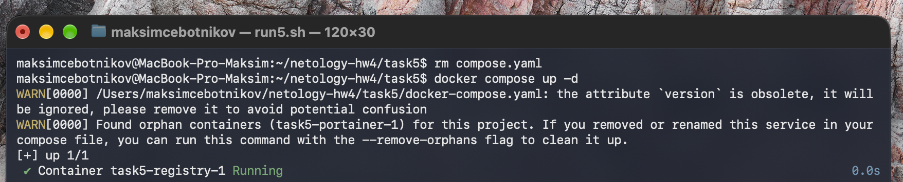

Compose выдал предупреждение:
`Found orphan containers (task5-portainer-1) for this project. If you removed or renamed this service in your compose file, you can run this command with the --remove-orphans flag to clean it up.`

Суть предупреждения. Compose связывает контейнеры с проектом по имени проекта (по умолчанию это имя каталога, `task5`) — на каждом контейнере стоит метка `com.docker.compose.project=task5`. После удаления `compose.yaml` Compose по приоритету имён взял `docker-compose.yaml`, где описан только `registry`. Контейнер `task5-portainer-1` при этом остался запущенным и по-прежнему помечен как часть проекта `task5`, но в текущей конфигурации его уже нет. Такой контейнер называется «осиротевшим» (orphan). Compose сам его не трогает, а только предупреждает и предлагает убрать ключом `--remove-orphans`.

Выполняю предложенное действие и гашу проект одной командой:
```bash
docker compose up -d --remove-orphans
docker compose down
```

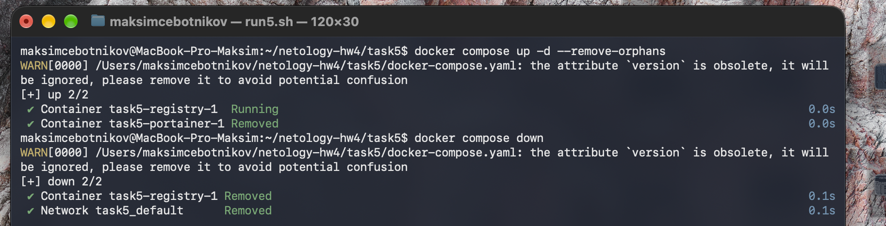

---

### Правила приема

Домашнее задание выполните в файле readme.md в GitHub-репозитории. В личном кабинете отправьте на проверку ссылку на .md-файл в вашем репозитории.
